# AI 产品红黑榜

> 一面在线贴纸投票墙：举起"好评 ✓ / 差评 ✕"牌，给 AI 产品打卡。灵感来自线下展会的投票墙。

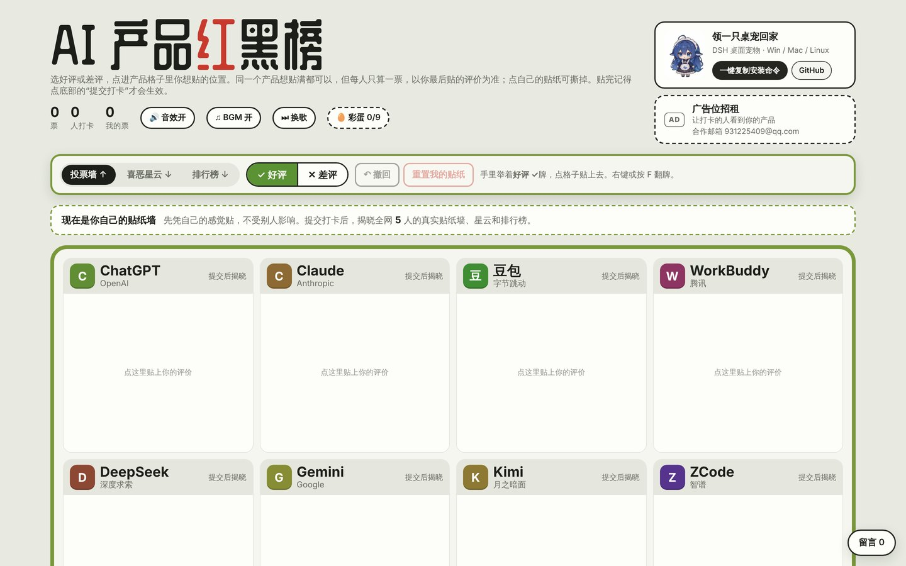

▶ **宣传讲解视频（87 秒，带字幕）**：[docs/video/promo.mp4](docs/video/promo.mp4)

## 截图

| 举牌贴纸，提交后才生效 | 提交后揭晓全网真实打卡墙 |
|---|---|
| 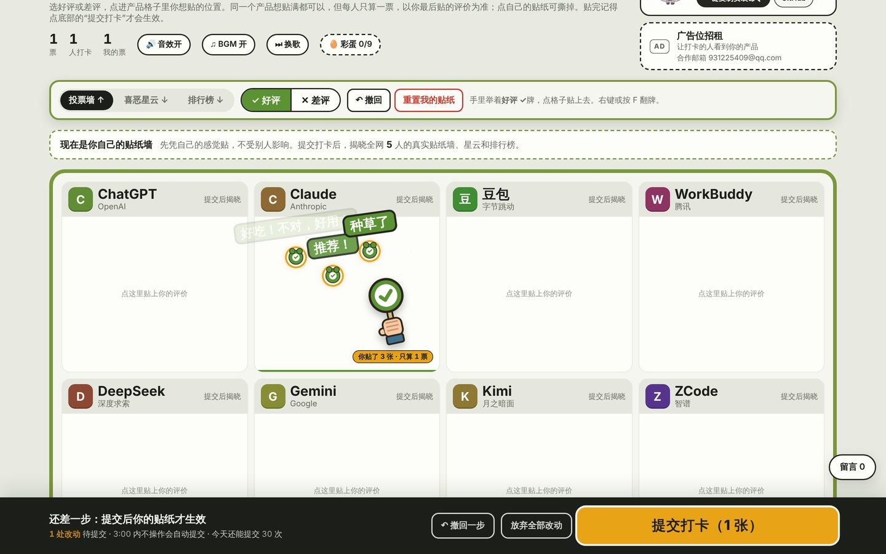 | 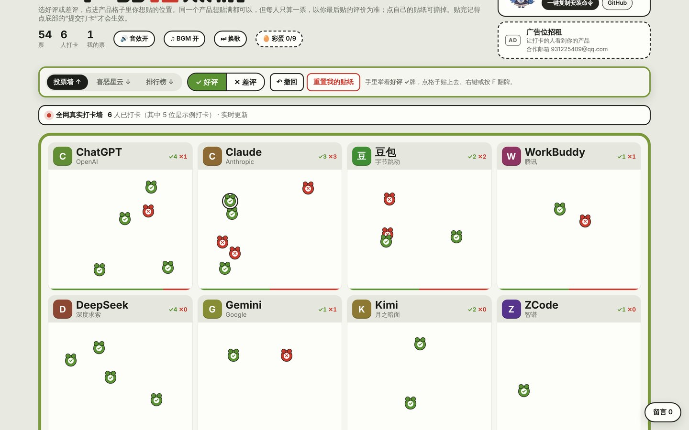 |
| **打卡成功** | **喜恶星云 + 滚动留言** |
| 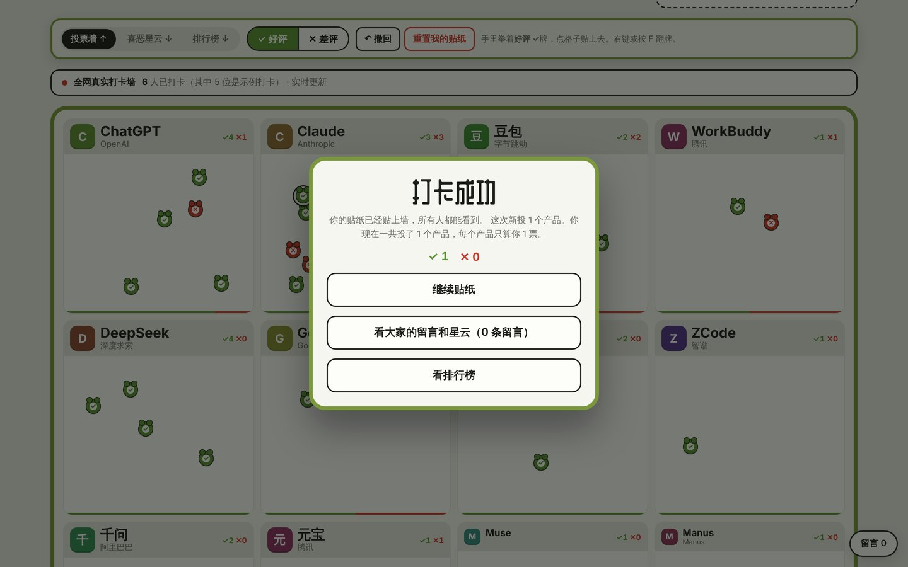 | 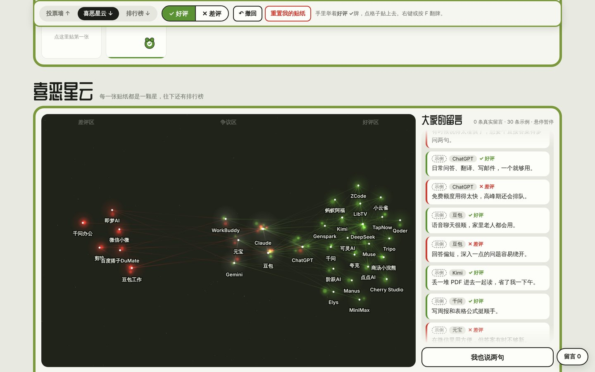 |
| **排行榜（好评向上、差评向下）** | **深色模式** |
| 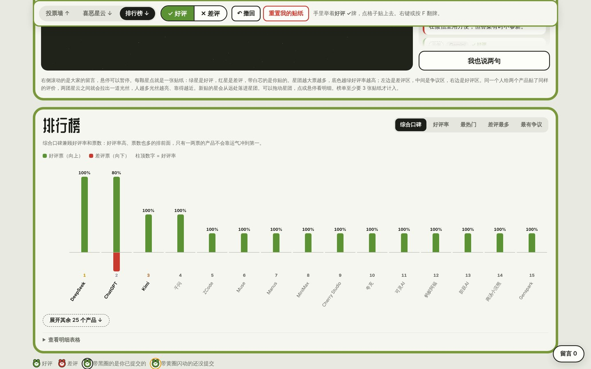 | 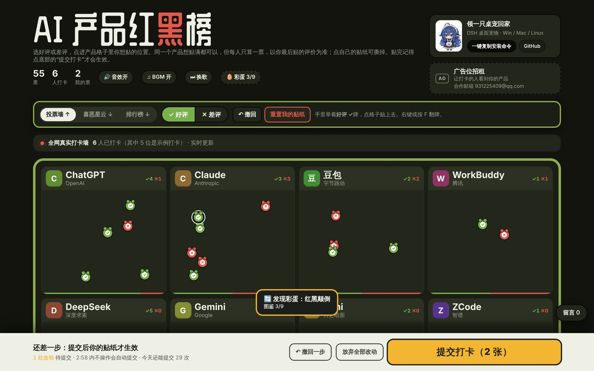 |

### 彩蛋

| 按住蓄力 | 松手"泰山压顶" |
|---|---|
| 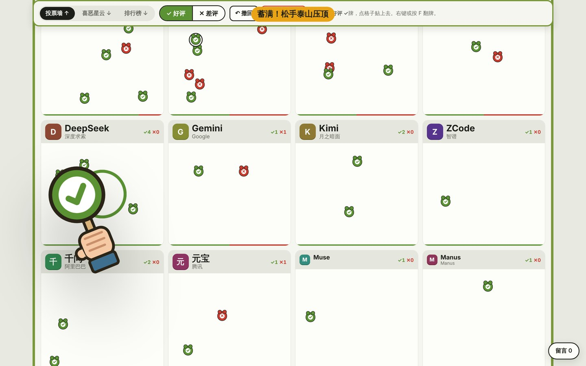 | 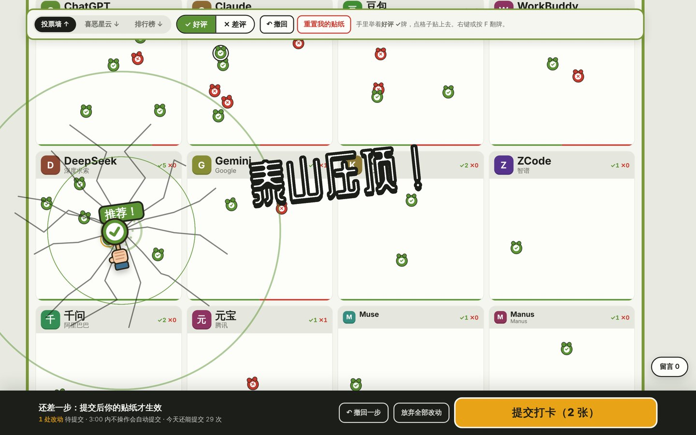 |
| **隐藏小游戏《打卡节奏达人》** | **彩蛋图鉴（9 个）** |
| 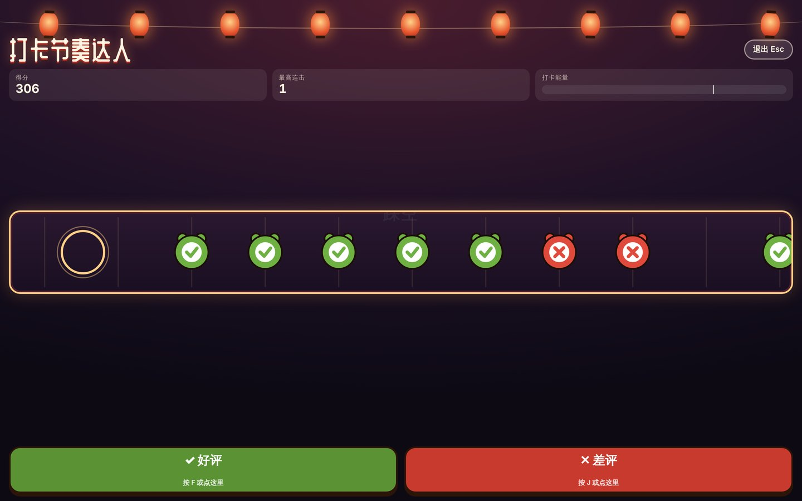 | 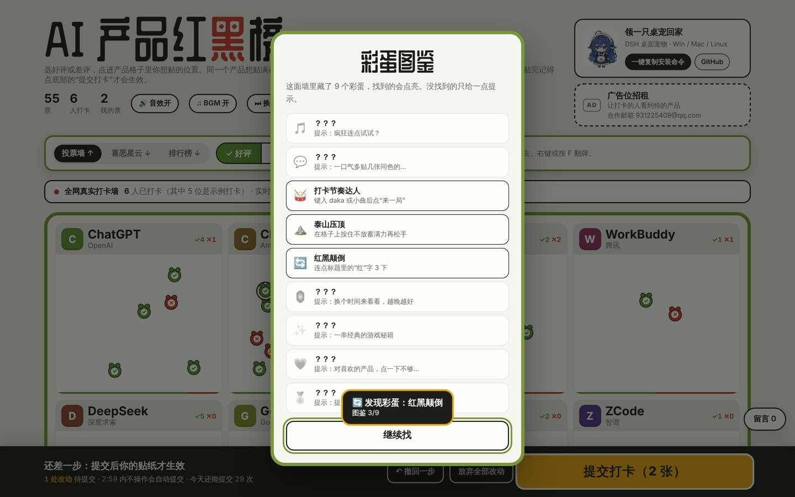 |

### 手机端

<p>
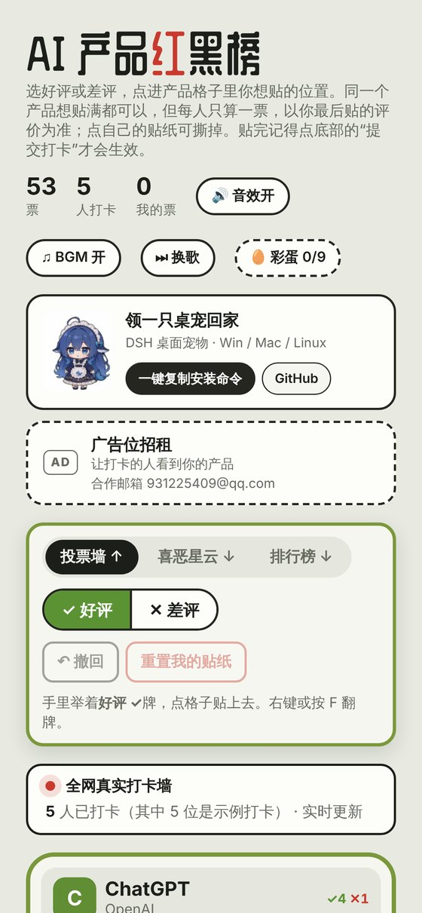
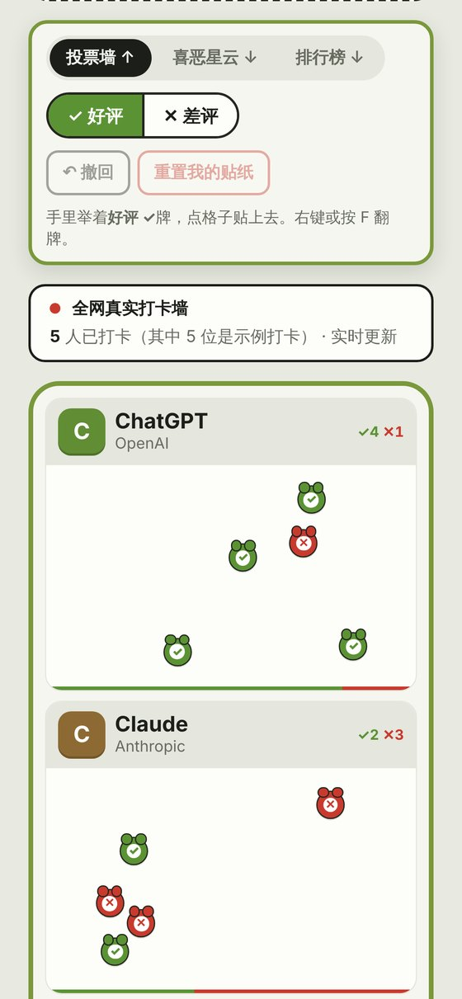
</p>

## 版权与修改权限

本仓库**公开展示，欢迎浏览和学习**，但**保留所有权利**（见 [LICENSE](LICENSE)）：

- 可以：查看源码和截图，在本地运行体验，学习参考。
- 需要申请：修改后公开发布、二次分发、商用、用于其他网站，都需要先发邮件申请书面授权，地址 931225409@qq.com。
- 想参与改进：请先开一个 Issue 说明想法。代码合并需要仓库所有者审核批准，详见 [CONTRIBUTING.md](CONTRIBUTING.md)。

---

在线贴纸投票墙：访客举着"好评 ✓ / 差评 ✕"牌给 AI 产品打卡。提交后揭晓全网真实打卡墙，往下滑能看到喜恶星云、滚动留言和排行榜（柱状图）。页面还带原创 BGM、9 个彩蛋和防刷机制。

当前线上版本运行在 claude.ai（第 24 版），已通过 26 项端到端测试，详见文末。

---

## 目录

```
site/                 网站本体
  index.html          整个页面（样式、脚本、桌宠图片都在里面，约 230KB）
  chars/*.webp        各产品 AI 娘形象（格子里的淡化背景图）
  music/*.mp3         4 首原创 BGM（嘻哈打卡 / 放克迪斯科 / 管风琴律动 / 尤克里里探店）
server/               自建服务器时用的防刷后台（Node.js）
  server.js           按 IP / 账号 / 设备限流 + 封禁 + 数据校验，参数在文件开头 LIMITS
  package.json
extras/
  wall-posters/       最早的 5 种风格红黑榜海报（正面 + 侧面）及生成脚本 render_wall.py
  bgm-source/         BGM 生成脚本（bgm.py、tracks.py），可改旋律重新生成
  demo-data/          线上那 5 位"示例打卡"的原始数据
  tests/fulltest.py   端到端测试脚本（Playwright）
```

---

## 上线方式（务必先读）

### 方式 A：继续用 claude.ai 上的版本（推荐，现成可用）
页面已经发布在 claude.ai，投票、留言、排行榜、测试名单的数据也都存在那里，可以直接用。

1. 打开页面右上角的"分享"。
2. 把访问权限设为"贡献者"，访客才能贴纸。设为"查看者"的人只能看、不能贴。
3. 访客需要登录 claude.ai。

### 方式 B：部署到自己的服务器（如腾讯云）
`site/index.html` 可以直接放到任意静态服务器上打开，但**数据功能要改代码才能用**。

- **原因**：页面的数据读写（投票、留言、节奏游戏排行榜、测试账号名单）和"当前是谁"都依赖 claude.ai 提供的 `window.claude.use("db")` 和 `use("user")` 接口，在别的网站上这两个接口不存在。
- **直接部署的后果**：页面能正常显示，也能贴纸，但提交不会保存，看不到别人的票，状态栏会提示"在 claude.ai 中打开这个页面才能贴纸"。
- **要在自己服务器上真正跑起来，需要三步**：
  1. **登录**：给网站加用户登录，用微信、手机号等都行，用来替代 `user.id()`。
  2. **接口**：用 `server/server.js` 作为后端。它已经提供了 `POST /api/votes`（提交打卡，带防刷）和 `GET /api/summary`（汇总）。留言、节奏游戏排行榜、测试名单的接口需要按同样方式补上。
  3. **改页面**：把页面里 `claude.use("db")` 的读写，改成调用上面这些接口（可以用轮询或 WebSocket 实现实时更新）。

---

## 防刷参数

### 页面里（`site/index.html` 开头的 `LIMITS`）
| 参数 | 当前值 | 含义 |
|---|---|---|
| MAX_VOTES | 不限 | 每人可投的产品数（每个产品只算 1 票） |
| MAX_SUBMITS_PER_DAY | 30 | 每人每天最多提交次数；超过的数据会被所有访客忽略 |
| MIN_SUBMIT_GAP_MS | 3000 | 两次提交最少间隔 |
| MAX_NOTES_PER_DAY | 30 | 每人每天最多留言数 |
| MAX_DECO | 99 | 普通用户每个产品最多贴 100 张，提交后合并为 1 张 = 1 票 |
| TESTER_MAX_DECO | 500 | 官方测试账号测试模式下的上限，每张都算一票 |

### 后台里（`server/server.js` 开头的 `LIMITS`）
- 同一 IP：每分钟最多 6 次提交，每天最多 30 次；一天最多出现 8 个不同账号。
- 同一账号或设备：每天最多 30 次，两次提交间隔至少 3 秒。
- 24 小时内触发限制 5 次，封禁该 IP 24 小时。
- 前面有负载均衡（CLB）或 Nginx 时，要设置环境变量 `TRUST_PROXY`。
- 文件末尾附了一段 Nginx 限流配置。

运行：
```
cd server && npm install
REDIS_URL=redis://127.0.0.1:6379 node server.js   # 有 Redis（多台服务器共享计数）
node server.js                                     # 无 Redis（单机内存计数）
```
`server.js` 里的登录校验只是占位，上线前要换成你自己的登录逻辑。

---

## 官方测试模式
页面所有者（你）的工具栏里有"🧪 测试模式"按钮：

- **开启时**：每贴一张都单独算一票，不限提交次数；墙顶会公开标注"含 N 张官方测试票"。
- **关闭后**：投票规则和普通用户完全一样。
- **防冒充**：测试账号名单存在 `testers` 里，只有页面所有者能写，普通用户无法冒充。

## 示例数据
线上目前有 5 位示例打卡（`demo-01` 到 `demo-05`）。墙顶会标注"其中 5 位是示例打卡"。正式开放前可以让 Claude 一键删除。

## 彩蛋（9 个）
1. 快速连点 16 下：播放一首小曲。
2. 连续贴同色评价：冒出一句标语。
3. 键入 daka：打开节奏小游戏。
4. 按住格子蓄力再松开：泰山压顶。
5. 连点标题里的"红"字 3 下：红黑颠倒。
6. 凌晨 0–5 点打开：深夜食堂。
7. 键入 ↑↑↓↓←→←→BA：下一张贴纸变成金色。
8. 双击格子：飘出爱心。
9. 提交时的评价分布：获得评委称号。

## 版权与素材说明
- BGM、彩蛋小曲、节奏游戏曲子均为程序原创生成，可放心使用。
- 产品名旁边是首字徽章，没有使用任何公司的 logo。
- 各产品的 AI 娘形象（`site/chars/`）由项目方提供，权利归原作者所有。
- 桌宠图片来自 dsh-pet 项目（https://github.com/PC2005-cloud/dsh-pet）。
- 产品热度排序参考：新京报 AI 研究院 2026 年 4–5 月榜单、Similarweb 2026 年数据，部分产品为估计。

## 已完成的测试（2026-10-25）
- **投票**：盲投、同一产品多点只算 1 票、撤回、Ctrl+Z、重置、3 秒内连续提交被拦截。
- **提交**：提交后自动揭晓全网真实墙、多贴的贴纸合并成 1 张、成功卡片按钮顺序。
- **数据展示**：排行榜柱状图（前 15 名及展开全部）、星云、滚动留言、发留言。
- **彩蛋与特效**：节奏小游戏打开/关闭、蓄力重压、红黑颠倒。
- **测试模式**：开启时每张算一票，关闭后恢复 1 票。
- **页面适配**：深色模式、电脑和手机宽度下都没有横向滚动。
- **稳定性**：全程无脚本错误；通过 HTTP 访问时 4 首 BGM 都能正常加载。
- **权限**：普通用户写入测试名单会被拒绝；"仅查看"权限能读到全部投票。
